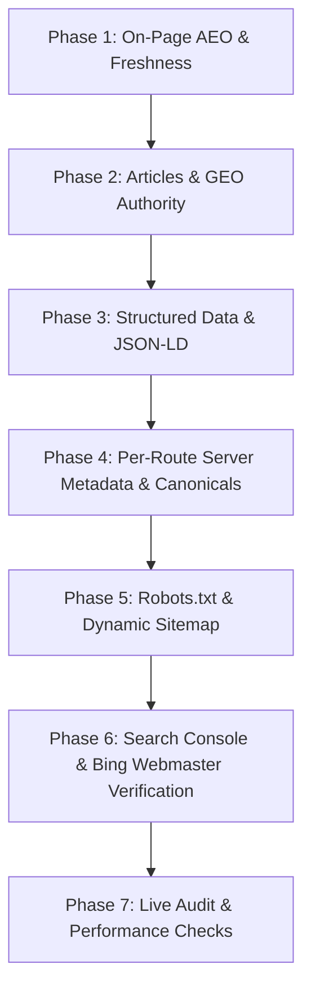

# Website Engine Optimization (SEO + AEO + GEO) Implementation Plan
**Client / Brand**: Cillah.dev (Operated by Cillah AI Automation &bull; BN-5559Q2JL &bull; Nairobi, Kenya)  
**Hosting / Stack**: Next.js 16 (App Router, Turbopack) &bull; React 19 &bull; Tailwind CSS &bull; Vercel  
**Canonical Domain**: `https://cillah.dev` (Secure HTTPS, lowercase, no `www`)  
**Target Engines**: Google, Bing/Yahoo, Perplexity, ChatGPT Search, Claude, Gemini  

---

## 1. Current Codebase Audit (What We Have vs. What We Need)

| Optimization Area | Current Status in Cillah.dev | Required Action |
| :--- | :--- | :--- |
| **Robots Directives** | ❌ Missing (`/robots.txt` does not exist) | Create `app/robots.ts` or `public/robots.txt` disallowing private routes (`/admin/*`, `/api/*`, `/dashboard/*`, etc.) and allowing public routes |
| **XML Sitemap** | ❌ Missing (`/sitemap.xml` does not exist) | Create dynamic `app/sitemap.ts` mapping all public 200 OK URLs with `lastmod`, `priority`, and `changefreq` |
| **Canonical URLs & Base** | ❌ Missing `metadataBase` & per-page canonicals | Set `metadataBase: new URL('https://cillah.dev')` in `layout.tsx` & canonical per-page metadata |
| **AEO (Answer Engine Optimization)** | ❌ No FAQ section exists on the site | Build a luxury, collapsible 10-Question FAQ section on the homepage and inject Schema.org `FAQPage` JSON-LD |
| **Freshness Signal** | ❌ No last-updated/audit timestamp | Add a sleek "Last system audit / updated: [Month Year]" badge to the footer |
| **GEO & Topical Authority** | ⚠️ Only 4 use-cases in markdown; no articles | Create `/articles` hub with 3 high-authority educational articles focused on AI automation, web applications, and CRM integration |
| **JSON-LD Structured Data** | ⚠️ Bare Organization schema in `layout.tsx` | Upgrade to comprehensive `Organization`, `WebSite`, `FAQPage`, and `Article` structured data |
| **Per-Route Metadata** | ⚠️ Client pages (`"use client"`) lack server meta | Add server `layout.tsx` with dedicated `<title>` and `<meta description>` for `/our-services`, `/book-consultation`, etc. |
| **Search Console & Bing Auth** | ❌ Not yet registered | Register with Google Search Console & Bing Webmaster Tools (including `BingSiteAuth.xml` in `public/`) |

---

## 2. The 3-Pillar Optimization Strategy: SEO + AEO + GEO

### Pillar 1: Classical SEO (Search Engine Optimization)
- **Goal**: Help Google and Bing crawlers index pages quickly, understand URL hierarchy, and rank keywords for businesses searching for software solutions and automation.
- **Core Standard**: `https://cillah.dev` (strictly HTTPS, lowercase, no `www`).
- **Target Keywords**:
  - *Primary*: Software solutions Nairobi, AI automation Kenya, custom web applications for business, WhatsApp AI agents, real estate operating system, CRM workflow automation.
  - *Secondary*: Autonomous sales chatbot, lead qualification automation, digital operating systems Nairobi.

### Pillar 2: AEO (Answer Engine Optimization)
- **Goal**: Win "Position Zero" in Google featured snippets and direct answers in Perplexity, Siri, and Bing Copilot.
- **Strategy**:
  - Implement **10 High-Intent Collapsible FAQs** directly addressing client questions, objections, and timelines.
  - Pair the FAQ section with a `type="application/ld+json"` schema of type **`FAQPage`** containing exact question-and-answer pairs. When an engine parses the page, the answer is already structured for direct extraction.

### Pillar 3: GEO (Generative Engine Optimization)
- **Goal**: Ensure LLMs (ChatGPT, Claude, Gemini, Perplexity) cite Cillah.dev when users ask: *"What company builds custom web apps and AI agents in Nairobi?"* or *"How can real estate businesses automate WhatsApp leads in Kenya?"*
- **Strategy**:
  - Create high-context, entity-rich content with the `/articles` hub.
  - Inject **Organization** and **LocalBusiness/ProfessionalService** Schema explicitly anchoring:
    - Legal name: `Cillah AI Automation` (BN-5559Q2JL)
    - Location: `Nairobi, Kenya`
    - Official domain: `https://cillah.dev`
    - Founder & Profiles: LinkedIn, Instagram, Facebook, TikTok
  - Use semantic definitions rather than keyword stuffing (context-rich sentences explaining lead flow, API webhooks, M-Pesa integration, and CRM routing).

---

## 3. Step-by-Step Implementation Roadmap



### Phase 1: On-Page AEO & Freshness
1. **Collapsible FAQ Section on Homepage** (`app/page.tsx`):
   - 10 targeted questions designed for business owners (timelines, how AI agents work in WhatsApp/IG, custom portal vs. WordPress, M-Pesa integration, pricing models, data security, etc.).
   - Accordion interaction styled to match the dark luxury aesthetic (`#1C1C1C` background, `#C9A66B` gold accents).
2. **Freshness Badge in Footer** (`components/footer.tsx`):
   - A subtle live audit/freshness badge: *"Last System & Knowledge Update: October 2026"* proving active maintenance to search crawlers.

### Phase 2: Articles & GEO Topical Authority (`/articles`)
1. Create `/articles` hub page:
   - Clean, luxury list of educational resources.
2. Publish **3 Static High-Authority Articles** (`content/articles`):
   - **Article 1**: *The Death of the Static Brochure Website: Why Modern Businesses Need an Operating System.*
   - **Article 2**: *How to Deploy an AI Agent Inside WhatsApp & Instagram to Close Sales 24/7.*
   - **Article 3**: *From Inquiries to Banked Revenue: Automating Marketing Channels Into a Single CRM.*
3. Add "Articles" navigation links to the Navbar and Footer.

### Phase 3: Structured Data & Schema Injection (JSON-LD)
1. **Root Organization Schema** (`app/layout.tsx`):
   - Full Organization entity with `legalName`, `url`, `logo`, `telephone`, `email`, `address` (Nairobi, Kenya), and `sameAs` social links.
2. **WebSite Schema with SearchAction**:
   - Enables rich branded sitelinks in search results.
3. **FAQPage Schema**:
   - Programmatically injected on the homepage with all 10 FAQs for immediate AEO indexing.
4. **Article Schema**:
   - Injected on each article page with `author`, `publisher`, `datePublished`, and `dateModified`.

### Phase 4: Per-Route Server Metadata & Canonical URLs
1. Update `app/layout.tsx`:
   - Set `metadataBase: new URL('https://cillah.dev')`.
   - Set default canonical link, OpenGraph image, and Twitter card.
2. Add server-rendered metadata layouts for client routes:
   - `app/our-services/layout.tsx`
   - `app/book-consultation/layout.tsx`
   - `app/use-cases/layout.tsx`
   - `app/pricing/layout.tsx`
   - `app/privacy-policy/layout.tsx`
   - `app/terms/layout.tsx`
3. Add `generateMetadata` for dynamic pages:
   - `app/use-cases/[slug]/page.tsx`
   - `app/articles/[slug]/page.tsx`

### Phase 5: Robots.txt & Dynamic XML Sitemap
1. **Robots.txt** (`app/robots.ts` or `public/robots.txt`):
   ```txt
   User-agent: *
   Allow: /
   Disallow: /admin/
   Disallow: /api/
   Disallow: /dashboard/
   Disallow: /client/
   Disallow: /user/
   Disallow: /(auth)/
   Disallow: /unauthorized

   Sitemap: https://cillah.dev/sitemap.xml
   ```
2. **Dynamic Sitemap** (`app/sitemap.ts`):
   - Crawls all static routes (`/`, `/our-services`, `/use-cases`, `/articles`, `/book-consultation`, `/pricing`, `/privacy-policy`, `/terms`).
   - Automatically crawls and appends all dynamic markdown slugs (`/use-cases/[slug]`, `/articles/[slug]`).
   - Assigns clean `lastModified`, `changeFrequency`, and `priority` (e.g. `1.0` for Home, `0.9` for Services, `0.8` for Articles).

### Phase 6: Search Engine Registration & Verification
1. **Google Search Console**:
   - Add property for `cillah.dev`.
   - Submit `https://cillah.dev/sitemap.xml`.
   - Request indexing via URL inspection.
2. **Microsoft Bing Webmaster Tools** (covers Yahoo):
   - Add site.
   - Place `BingSiteAuth.xml` in `public/` folder (resolves the root file gotcha).
   - Submit sitemap and run a Site Scan.

### Phase 7: Live Audit & Performance Testing
1. Verify live URLs via terminal:
   - `curl -I https://cillah.dev` (confirm 200 OK & headers).
   - `curl https://cillah.dev/robots.txt` (confirm correct disallow & sitemap pointer).
   - `curl https://cillah.dev/sitemap.xml` (confirm valid XML output).
2. Test Rich Results:
   - Google Rich Results Test (confirm Organization and FAQPage schemas pass with zero errors).
3. Free assessment scans:
   - Webflow AEO Assessment tool.
   - Semrush free domain & AI Search overview.

---

## 4. Execution Discipline
Per the lesson guidance: we will proceed **ONE POINT AT A TIME**, validating and testing each phase thoroughly before moving to the next.
